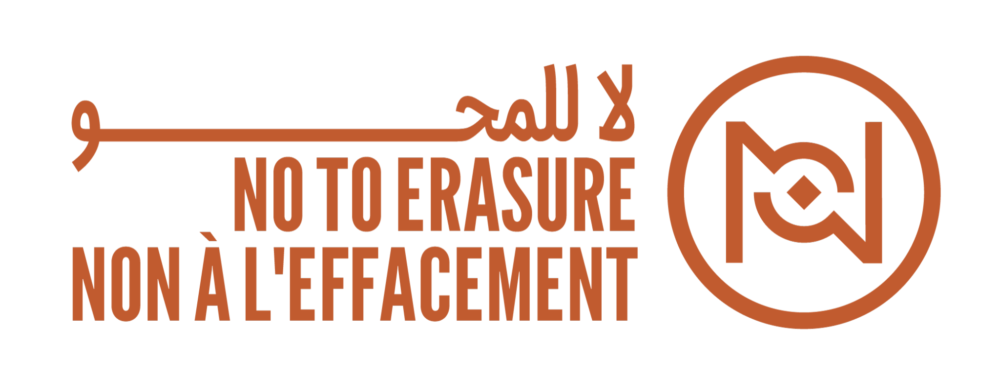

  

# No To Erasure — 3D Exhibition

*No To Erasure Day* is a project of the American University of Beirut (AUB) Libraries. This virtual exhibition presents works from the project's Primary Documents collection, including artwork, maps, documents, and film.

- [Visit the live 3D exhibition](https://mohamad-hk22.github.io/no-to-erasure-expo/)
- [Read about the AUB Libraries project](https://aub.edu.lb.libguides.com/no-to-erasure/home)
- [Explore the Primary Documents](https://aub.edu.lb.libguides.com/no-to-erasure/primary-documents)
- [View the Virtual Exhibition page on AUB LibGuides](https://aub.edu.lb.libguides.com/c.php?g=1560148&p=11716053)

## Explore the gallery

Drag to look around and use the arrow keys or **W**, **A**, **S**, and **D** to move. Use the minimap to jump to a themed area. Select an exhibit in the gallery or in the works strip below it to view the artwork, read the document, or play the film.

## Credits

AUB Libraries provides the project and collection. Individual credits and source links appear in the exhibit panels where available. The 3D viewer uses [OpenVGAL](https://github.com/lbartworks/openvgal). See the [runtime notice](gallery/NOTICE.txt) for third-party credits and licenses.
